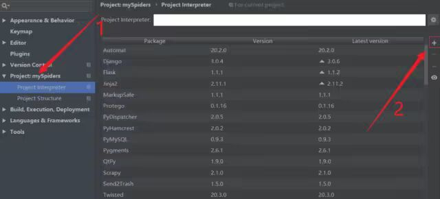
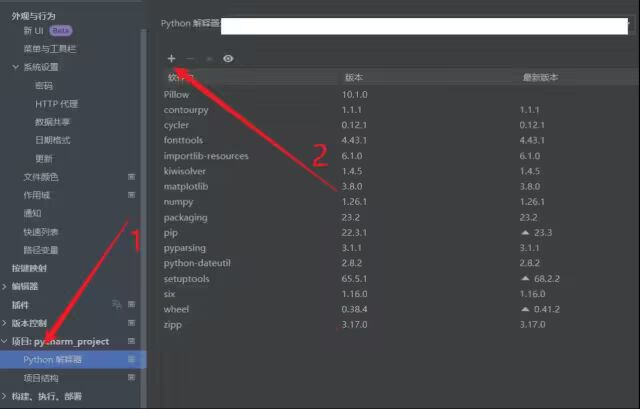
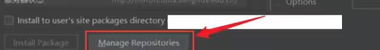
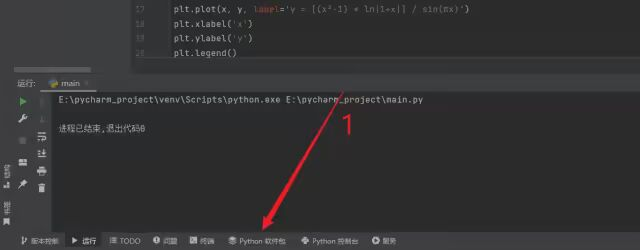
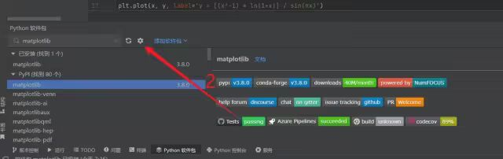
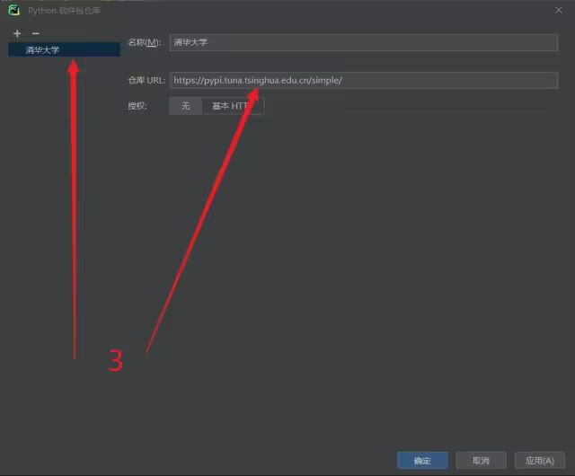
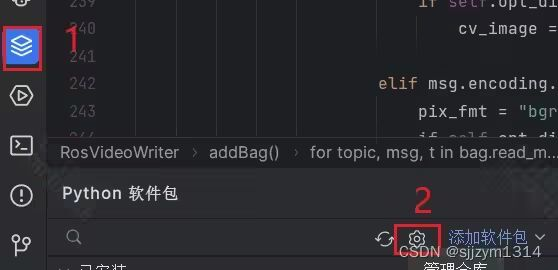
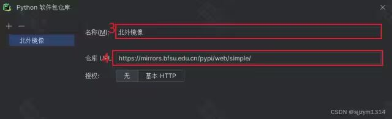
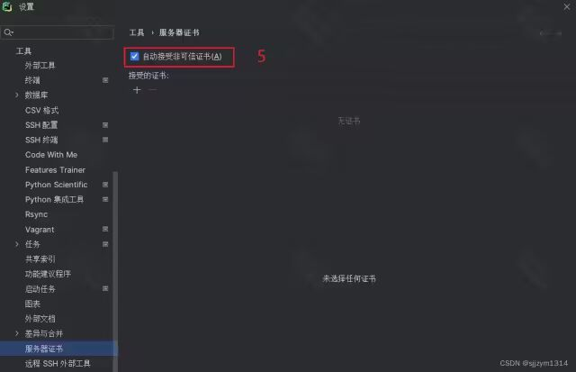

# [Python] PyCharm Setting Tsinghua Source

There are several domestic mirror sources, and it is recommended to choose the Tsinghua source.

There are several domestic mirror sources, and it is recommended to choose the Tsinghua source.

Tsinghua: https://pypi.tuna.tsinghua.edu.cn/simple

Alibaba Cloud: http://mirrors.aliyun.com/pypi/simple/

China University of Science and Technology https://pypi.mirrors.ustc.edu.cn/simple/

Douban: http://pypi.douban.com/simple/

## PyCharm 2018 and earlier version configuration methods:

1. First, you can refer to the two images below [the "+" symbols may appear in different places, help everyone find them in both Chinese and English].

2. Then click "Manage Repositories"

3. Then click "+" to add the mirror source address. Note that you need to delete the original one, otherwise it will interfere with your new mirror.

## PyCharm 2021-2022 Version Settings Method

First, create a project randomly and then follow the diagram to execute it.

## For the new UI in 2023, there are also solutions, as follows:

## PyCharm 2023 Add Mirror Sources

File -> Settings -> Tools -> Server Certificate: Check the box for Auto accept untrusted certificates

The above content is the method of setting up PyCharm with different versions and UI mirror sources, which hopefully will be helpful to everyone.

## Payment

Here is a pay link on Stripe ( https://buy.stripe.com/3cs8yP7sY87d0vu9AB ). Please contact me lonlonago@foxmail.com after funding $89, and I will send you a complete data files , thank you!

